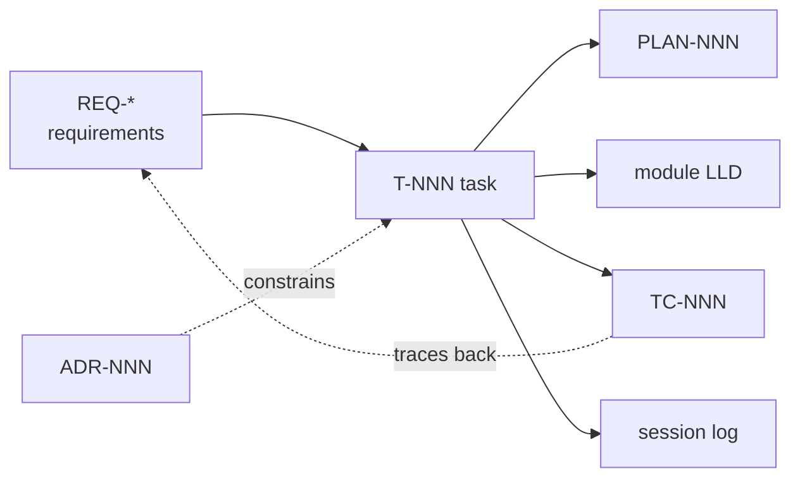

# ARCHP Documentation

The single home for everything needed to understand, continue, defend and maintain ARCHP.

## Map

| Folder | Holds | Index |
|---|---|---|
| `architecture/` | High-level design: ISA, datapath, pipeline stages and registers, hazards, interrupts, resources | [HLD.md](architecture/HLD.md) |
| `modules/<name>/` | Low-level design per module (how it's built) | [modules/README.md](modules/README.md) |
| `decisions/` | Architecture Decision Records (`ADR-NNN`) — what we decided and why | [decisions/README.md](decisions/README.md) |
| `tasks/` | Task specs + status (`T-NNN`). **Source of truth for status.** Includes "Explain it" for the code defense | [tasks/README.md](tasks/README.md) |
| `implementationPlans/` | Step-by-step plan per task (`PLAN-NNN`, same number as task) | [implementationPlans/README.md](implementationPlans/README.md) |
| `TCs/` | Acceptance test cases for ARCHP (`TC-NNN`), traced to the brief and the grading table | [TCs/README.md](TCs/README.md) |
| `SystemGuides/` | How-to guides (`SG-NNN`): setup, assembler, simulation, ModelSim demo, Quartus | [SystemGuides/README.md](SystemGuides/README.md) |
| `RefrenceDocs/` | The project brief, extracted requirements (`REQ-*`), external references | [RefrenceDocs/README.md](RefrenceDocs/README.md) |
| `reports/` | Submission reports (Phase 1 design report, Phase 2 report) and their PDFs | [reports/README.md](reports/README.md) |
| `sessions/` | Session logs and handoffs (`YYYY-MM-DD-SNNN-slug.md`) | [sessions/README.md](sessions/README.md) |

## How the pieces connect

- Every task lists the `REQ`s it satisfies, the modules it touches, and the `TC`s that verify it.
- Every TC lists the `REQ`/grading line it proves.
- Decisions are never edited away: superseded ADRs are marked `Superseded by ADR-NNN`.

## Conventions
See [../CLAUDE.md](../CLAUDE.md) for the session protocol, Definition of Done, and ID conventions.

## Templates
- Task: [tasks/_TEMPLATE.md](tasks/_TEMPLATE.md)
- Plan: [implementationPlans/_TEMPLATE.md](implementationPlans/_TEMPLATE.md)
- ADR: [decisions/_TEMPLATE.md](decisions/_TEMPLATE.md)
- Module LLD: [modules/_TEMPLATE.md](modules/_TEMPLATE.md)
- Session: [sessions/_TEMPLATE.md](sessions/_TEMPLATE.md)
- Acceptance TC: [TCs/_TEMPLATE.md](TCs/_TEMPLATE.md)
- System guide: [SystemGuides/_TEMPLATE.md](SystemGuides/_TEMPLATE.md)
