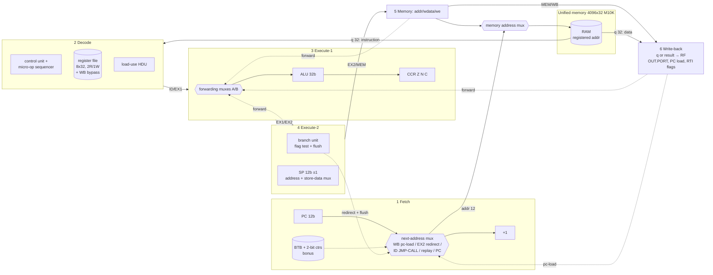

# ARCHP — High-Level Design

- **Status:** Design (T-001). Each section is marked when the RTL implements it; module LLDs in [../modules/](../modules/README.md) hold the "as built" detail.
- **Brief:** [Architecture_Project_Fa26.pdf](../RefrenceDocs/Architecture_Project_Fa26.pdf) · requirements [REQ-*](../RefrenceDocs/REQ-requirements.md) · decisions [ADR-*](../decisions/README.md)

## 1. Overview

ARCHP is a 32-bit RISC-like processor with a 6-stage in-order pipeline and a single Von-Neumann memory:

| # | Stage | Short | Work done |
|---|---|---|---|
| 1 | Fetch | IF | Choose the next fetch address (PC, redirects, replay), drive the memory address when the memory is free, update PC. Bonus: BTB lookup. |
| 2 | Decode | ID | Instruction word arrives from the memory (synchronous read). Control unit, micro-op sequencer (SWAP / INT / interrupt), register-file read with write-back bypass, load-use hazard detection, JMP/CALL redirect. |
| 3 | Execute-1 | EX1 | Forwarding muxes, ALU (incl. LDD/STD effective address `Rsrc+offset`), IN.PORT sample, flag (CCR) update. |
| 4 | Execute-2 | EX2 | Branch resolution (JZ/JN/JC) + flush, stack address arithmetic (SP±1), final memory address and store-data formation. |
| 5 | Memory | MEM | Memory access (has priority over fetch: structural hazard). |
| 6 | Write-Back | WB | Register-file write (ALU result or memory data), OUT.PORT, PC load from memory (RET/RTI/vectors), flag restore (RTI). |

Key properties (each justified by an ADR):

- **One instruction = one 32-bit word** ([ADR-003](../decisions/ADR-003-instruction-format.md)).
- **One single-port 4096 x 32 memory** in M10K blocks; the MEM stage has priority, fetch stalls ([ADR-004](../decisions/ADR-004-unified-memory.md)).
- The synchronous memory's registered address makes the memory output the **IF/ID instruction register**: no extra 32-bit IR, and stalls are handled by **replay** (re-fetching the instruction held in decode).
- **PC and SP are 12-bit registers** internally, presented as 32-bit values ([ADR-009](../decisions/ADR-009-pc-sp-width.md)).
- **Multi-cycle instructions are split into micro-ops** by the decode sequencer: SWAP (2 register writes, one write port), INT and the hardware interrupt (a push and a vector read, one memory port) ([ADR-007](../decisions/ADR-007-interrupts.md), [ADR-008](../decisions/ADR-008-swap-micro-ops.md)).
- **Static prediction: not-taken** for JZ/JN/JC (resolved in EX2); JMP/CALL redirect in decode with **zero** bubbles ([ADR-011](../decisions/ADR-011-static-branch-prediction.md)). Bonus: 2-bit counters + BTB in fetch behind `G_DYNAMIC_BP` ([ADR-012](../decisions/ADR-012-dynamic-branch-prediction.md)).

## 2. Programmer-visible state

| Element | Spec | Physical | Reset value |
|---|---|---|---|
| R0–R7 | 8 x 32 bit | 8 x 32 flip-flops | 0 |
| PC | 32 bit | 12 bit (zero-extended view) | M[0] (loaded by the boot sequence) |
| SP | 32 bit | 12 bit (zero-extended view) | 0xFFF |
| CCR | CCR<3:0>: Z=<0>, N=<1>, C=<2> | 3 flip-flops (CCR<3> reads 0) | 000 |
| OUT.PORT | 32 bit | register written in WB | 0 |
| Memory | 4096 x 32, synchronous read | one M10K-inferred single-port RAM | loaded from the program file |

### Memory map
| Address | Contents |
|---|---|
| M[0] | Reset vector: PC ← M[0] |
| M[1] | Hardware-interrupt vector: PC ← M[1] |
| M[2], M[3] | `INT 0`, `INT 1` vectors: PC ← M[index+2] |
| anywhere (via `.ORG`) | code and data |
| top of memory, growing down from 0xFFF | stack |

## 3. Instruction set architecture

### 3.1 Format (one 32-bit word, [ADR-003](../decisions/ADR-003-instruction-format.md))

```
 31      27 26   24 23   21 20   18 17 16 15                              0
┌──────────┬───────┬───────┬───────┬─────┬─────────────────────────────────┐
│ opcode 5 │ Rd  3 │ Ra  3 │ Rb  3 │ 0 0 │ Imm / Offset / target / index 16│
└──────────┴───────┴───────┴───────┴─────┴─────────────────────────────────┘
```

- `Rd` [26:24] — **register-file write address**.
- `Ra` [23:21] — **read port A** (ALU operand A, LDD/STD base, OUT source).
- `Rb` [20:18] — **read port B** (ALU operand B, PUSH/STD store data).
- Fixed positions mean the register file is addressed straight from the instruction bits (no address muxes in decode except for the SWAP second micro-op). The assembler places each operand in the field of the port that uses it.

### 3.2 Opcodes and operand placement

| Opcode | Mnemonic | Rd | Ra | Rb | Imm | Operation | Flags |
|---|---|---|---|---|---|---|---|
| 00000 | NOP | – | – | – | – | — | – |
| 00001 | HLT | – | – | – | – | stop fetching until reset ([ADR-010](../decisions/ADR-010-hlt.md)) | – |
| 00010 | SETC | – | – | – | – | C ← 1 | C |
| 00011 | NOT Rdst | Rdst | Rdst | – | – | R ← ~R | Z N |
| 00100 | INC Rdst | Rdst | Rdst | – | – | R ← R+1 | Z N C |
| 00101 | OUT Rsrc | – | Rsrc | – | – | OUT.PORT ← R | – |
| 00110 | IN Rdst | Rdst | – | – | – | R ← IN.PORT | – |
| 00111 | MOV Rdst,Rsrc | Rdst | Rsrc | – | – | Rdst ← Rsrc | – |
| 01000 | SWAP Rdst,Rsrc | Rdst | Rsrc | Rdst | – | exchange (2 micro-ops) | – |
| 01001 | ADD Rdst,Rs1,Rs2 | Rdst | Rs1 | Rs2 | – | Rs1+Rs2 | Z N C |
| 01010 | SUB Rdst,Rs1,Rs2 | Rdst | Rs1 | Rs2 | – | Rs1−Rs2 (C = borrow) | Z N C |
| 01011 | AND Rdst,Rs1,Rs2 | Rdst | Rs1 | Rs2 | – | Rs1 & Rs2 | Z N |
| 01100 | IADD Rdst,Rsrc,Imm | Rdst | Rsrc | – | Imm | Rsrc + sext(Imm) | Z N C |
| 01101 | CMP Rdst,Rsrc | – | Rdst | Rsrc | – | Rdst−Rsrc, discarded | Z N C |
| 01110 | SHR Rdst,Imm | Rdst | Rdst | – | Imm | logical >> Imm[4:0] | Z N |
| 01111 | SHL Rdst,Imm | Rdst | Rdst | – | Imm | << Imm[4:0] | Z N C (C if Imm[4:0]≠0) |
| 10000 | PUSH Rsrc | – | – | Rsrc | – | X[SP] ← R; SP−=1 | – |
| 10001 | POP Rdst | Rdst | – | – | – | SP+=1; R ← X[SP] | – |
| 10010 | LDM Rdst,Imm | Rdst | – | – | Imm | R ← zext(Imm) | – |
| 10011 | LDD Rdst,off(Rsrc) | Rdst | Rsrc | – | off | R ← M[Rsrc+off] | – |
| 10100 | STD Rs1,off(Rs2) | – | Rs2 (base) | Rs1 (data) | off | M[Rs2+off] ← Rs1 | – |
| 10101 | JZ Imm | – | – | – | target | if Z: PC ← Imm, Z ← 0 | Z |
| 10110 | JN Imm | – | – | – | target | if N: PC ← Imm, N ← 0 | N |
| 10111 | JC Imm | – | – | – | target | if C: PC ← Imm, C ← 0 | C |
| 11000 | JMP Imm | – | – | – | target | PC ← Imm | – |
| 11001 | CALL Imm | – | – | – | target | X[SP] ← PC+1; SP−=1; PC ← Imm | – |
| 11010 | RET | – | – | – | – | SP+=1; PC ← X[SP] | – |
| 11011 | INT index | – | – | – | index (0/1) | X[SP] ← {flags, PC+1}; SP−=1; PC ← M[index+2] | – |
| 11100 | RTI | – | – | – | – | SP+=1; {flags, PC} ← X[SP] | Z N C (restored) |
| 11101–11111 | (unused) | | | | | executes as NOP | |

Notes:
- Opcode 00000 = NOP, so zero-filled memory executes as NOPs.
- JZ/JN/JC = `101cc` where `cc` (opcode[1:0]) directly selects the tested flag (01 Z, 10 N, 11 C).
- Saved-context word (INT, interrupt): `[31]=C [30]=N [29]=Z`, `[11:0]=return PC`, other bits 0 ([ADR-007](../decisions/ADR-007-interrupts.md)). CALL pushes the plain return address.
- Immediates: LDM zero-extends; IADD and offsets sign-extend ([ADR-005](../decisions/ADR-005-immediate-extension.md)). Jump targets use Imm[11:0].

## 4. Datapath



The full schematic with every bus width is produced in T-012 ([reports/](../reports/README.md)); this section is the reference it is drawn from.

### 4.1 Fetch (IF) and the next-address mux
Each cycle the fetch unit computes `target` (12 bit) by priority:

| Priority | Condition | target |
|---|---|---|
| 1 | boot cycle after reset (`bootq`) or WB `pc_load` (RET / RTI / INT vector / interrupt vector) | `q[11:0]` (memory data in WB) |
| 2 | EX2 redirect (branch mispredict) | taken ? `imm` : `npc` |
| 3 | ID JMP / CALL | `imm` from the instruction word |
| 4 | ID replay (stall, multi-micro-op instruction) | `id_pc` |
| 5 | otherwise | `PC` (or the BTB prediction, bonus) |

- **Fetch allowed** (`fetch_en`) when the MEM stage does not need the memory, the core is not halted, and decode is not waiting for a PC load (RET/RTI/INT). Then memory address = `target`, `PC ← target+1`, `fv ← 1`, `id_pc ← target`.
- Otherwise `PC ← target` (the target is remembered and fetched later) and `fv ← 0` (decode sees a bubble).

### 4.2 Decode (ID)
- **Control unit:** opcode → control word (table in [modules/decode](../modules/decode/README.md)).
- **Register file:** two combinational read ports (`Ra`, `Rb`), one write port (WB). A **write-back bypass** returns the WB value when WB writes the register being read in the same cycle.
- **Load-use hazard detection:** a source in use that matches the `Rd` of a load (LDD/POP) in EX1 or EX2 → stall (bubble into EX1, replay the instruction).
- **Micro-op sequencer:** a 2-bit phase register:
  - SWAP = uop1 `Rd ← R[Ra]`, then uop2 `Ra ← R[Rb]`. uop2 does not take forwarding from EX2, where uop1 is.
  - INT = push `{flags, PC+1}`, then a vector read from `2+index`.
  - Interrupt = push `{flags, id_pc}`, then a vector read from `1`.
- **Redirects:** JMP/CALL steer the fetch address in the same cycle (no bubble). RET/RTI/INT phase 2/interrupt phase 2 set `wait` (no fetching until the PC load in WB). HLT sets `halted`.
- **Interrupt injection:** a latched `int_pending` replaces the valid instruction in decode with the interrupt micro-ops (that instruction re-executes after RTI).

### 4.3 Execute-1 (EX1)
- **Forwarding** for A and B from EX2 (ALU result), MEM (ALU result) and WB (ALU result or memory data), youngest first.
- **ALU ops:** ADD, SUB, AND, NOT, INC, PASSA, PASSB, SHL, SHR, IN, SETC. The B input is the register or the extended immediate.
- LDD/STD compute the effective address `Ra + sext(off)` here with the same adder ([ADR-014](../decisions/ADR-014-stage-mapping.md)).
- **CCR** is written at the end of EX1 (`flags_we`), unless EX2 flushes EX1 in that cycle.

### 4.4 Execute-2 (EX2)
- **Branch unit:** JZ/JN/JC test CCR (all older flag writers have already passed EX1, so no flag forwarding is needed).
  - Taken: clear the tested flag and compare with the prediction.
  - Mispredict: flush ID and EX1 and redirect fetch.
- **Stack unit:** `SP±1` (12-bit). Push: address = SP, SP ← SP−1. Pop: SP ← SP+1, address = SP+1. Other memory ops use address = the ALU result.
- **Store data:** `B` (PUSH/STD), the return PC (CALL), or `{CCR, return PC}` (INT / interrupt).
- **EX2/MEM.data** holds the store data for writes and the ALU result otherwise (one shared 32-bit field).

### 4.5 Memory (MEM)
If the instruction in MEM reads or writes the memory, it owns the address port this cycle (fetch stalls). The address is registered by the RAM, and read data appears in the next cycle (WB).

### 4.6 Write-back (WB)
- **Register write:** `wdata = wb_mem ? q : data`.
- **OUT.PORT** ← `data` for OUT.
- **`pc_load`:** fetch target ← `q[11:0]`, and `wait` is cleared.
- **RTI:** CCR ← `q[31:29]`.

## 5. Pipeline registers

| Register | Contents (bits) | ≈ bits |
|---|---|---|
| IF/ID | instruction = RAM output (32, inside the M10K); `fv` 1, `id_pc` 12 (+`id_npc` 12, `pred` 1 in the dynamic build) | 13 FF (+13) |
| ID/EX1 | valid, retire, reg_we, wb_mem, alu_op 4, b_imm, imm_sext, flags_we, is_out, mem_rd, mem_wr, stack 2, wsel 2, br 2, pc_load, rti, swap2, hwint, pred; Rd 3, Ra 3, Rb 3; A 32, B 32; imm 16; ret_pc 12 | ≈ 140 |
| EX1/EX2 | valid, retire, reg_we, wb_mem, is_out, mem_rd, mem_wr, stack 2, wsel 2, br 2, pc_load, rti, hwint, pred; Rd 3; result 32; B 32; target 12; ret_pc 12 | ≈ 115 |
| EX2/MEM | valid, retire, reg_we, wb_mem, is_out, mem_rd, mem_wr, pc_load, rti, hwint; Rd 3; addr 12; data 32 | ≈ 57 |
| MEM/WB | valid, retire, reg_we, wb_mem, is_out, pc_load, rti, hwint; Rd 3; data 32 (memory data comes straight from the RAM output) | ≈ 43 |

Exact field lists live in `rtl/pkg/archp_pkg.vhd` and [modules/pipeline](../modules/pipeline/README.md).

## 6. Hazards and their solutions

### 6.1 Structural hazards
| Hazard | Solution |
|---|---|
| Fetch and MEM both need the single memory port | MEM has priority. Fetch is blocked that cycle (`fv=0`, bubble in decode) and the target is kept in PC. |
| SWAP needs two register writes (one write port) | Two micro-ops through the pipeline, each writing once ([ADR-008](../decisions/ADR-008-swap-micro-ops.md)). |
| INT / interrupt need two memory accesses (push + vector read) | Two micro-ops: push, then vector read ([ADR-007](../decisions/ADR-007-interrupts.md)). |
| Register file read (ID) and write (WB) in the same cycle | Write-back bypass in the read path (same effect as "write first half, read second half"). |

### 6.2 Data hazards
| Hazard | Solution |
|---|---|
| ALU result needed by the next 1–3 instructions | Forwarding to EX1 from EX2, MEM, WB. |
| Producer in WB while the consumer is in ID | Register-file bypass. |
| Load (LDD/POP) followed by a use | Data exists only in WB (synchronous RAM). HDU stalls the consumer in ID until the load reaches WB, then forwards: distance 1 → 2 stalls, distance 2 → 1 stall, ≥3 → none. |
| Flags (JZ/JN/JC after ALU op) | CCR is written in EX1 and read in EX2, so every older writer has already written it. Same-cycle "branch clears flag" + "younger op sets flags": the younger op wins. |
| SP (back-to-back PUSH/POP/CALL/RET) | SP is read and written only in EX2, in program order. |
| SWAP uop2 reading the register uop1 just wrote | uop2 skips EX2 forwarding (uop1 is there); the register file still holds the old value. |

### 6.3 Control hazards
| Case | Handling | Penalty |
|---|---|---|
| JMP, CALL | Redirect in ID in the same cycle the instruction arrives | 0 |
| JZ/JN/JC not taken (predicted not-taken) | Fall through | 0 |
| JZ/JN/JC taken | Resolved in EX2: flush ID and EX1, redirect | 2 |
| RET, RTI | `wait` after decode; PC ← popped word in WB | 4 |
| INT n, interrupt | Push uop + vector uop, `wait`; PC ← vector in WB | 5 |
| Bonus predictor correct | BTB/2-bit counter predicts in fetch | 0 |

### 6.4 Interrupt corner cases ([ADR-007](../decisions/ADR-007-interrupts.md))
- **Edge capture:** INTR.IN is edge-detected and latched in `int_pending`, which clears only when the interrupt push micro-op reaches EX2 (EX2 is never flushed).
- **Injection:** only on a valid instruction in decode, which becomes the return address. Never during a multi-micro-op sequence, a `wait`, or after HLT.
- **Wrong path:** if the decode instruction is on a wrong path (an older branch in EX2 mispredicts), the injected micro-ops are flushed with it, `int_pending` stays set, and the interrupt is re-injected on the correct path. This is the brief's "corner cases like branching".

## 7. Reset, boot and halt
- **RESET.IN** is synchronous and active high. It clears every pipeline register (valid = 0), the register file, CCR and OUT, and sets SP = 0xFFF. Boot then reads M[0] and loads it into PC.
- **HLT** sets `halted`. Fetching stops, older instructions drain, and only reset leaves the state ([ADR-010](../decisions/ADR-010-hlt.md)).

## 8. Verification architecture ([ADR-013](../decisions/ADR-013-verification-strategy.md))
- **`archp.assembler`:** TA-format `.asm` → `.mem` (one hex word per line, 4096 lines) and `.mif` (Quartus).
- **`archp.golden`:** instruction-level ISA simulator. This is the executable specification.
- **`tb/tb_processor.vhd` + GHDL:** loads the `.mem` file, drives IN.PORT from an input list (advanced by the `in_rd` strobe) and INTR.IN at given cycles, runs to HLT, and dumps architectural state plus the OUT/interrupt/retire logs.
- **`archp.compare`:** runs every program on both and compares registers, SP, flags, OUT sequence and full memory. It runs in CI for **both** predictor builds.
- **ModelSim:** do-files reproduce the demo waveform with the required signals only.

## 9. Resource assumptions (Cyclone V 5CSEMA5F31C6)
- Memory: 4096 x 32 = 131,072 bits = 16 M10K blocks (fixed by the spec, not ranked).
- Largest logic consumers: register file (256 FF + 2 x 8:1 x 32 read muxes), the forwarding muxes (2 x 4:1 x 32), the ALU (adder plus 2 shifters) and the pipeline registers (~355 FF).
- Area levers applied: 12-bit PC/SP, a single register write port, a shared EX2/MEM data field, `id_npc` = PC in the static build, and the RAM output reused as the IR.
- The T-011 Flow Summary is the authority, and this section is updated with the real numbers.

## 10. Module map
See [modules/README.md](../modules/README.md). Directory layout:

```
rtl/pkg/       archp_pkg.vhd — opcodes, control record, pipeline register records
rtl/memory/    unified_memory.vhd
rtl/fetch/     fetch_unit.vhd, btb.vhd (bonus)
rtl/decode/    control_unit.vhd, decode_stage.vhd, register_file.vhd
rtl/execute/   alu.vhd, forwarding_unit.vhd, ex1_stage.vhd, ex2_stage.vhd, ccr.vhd
rtl/pipeline/  id_ex1_reg.vhd, ex1_ex2_reg.vhd, ex2_mem_reg.vhd, mem_wb_reg.vhd
rtl/core/      processor_core.vhd (integration + debug ports)
rtl/top/       processor_top.vhd  (Quartus top: spec ports only)
tb/            tb_processor.vhd, unit/ tb_*.vhd
src/archp/     isa.py, assembler.py, golden.py, ghdl.py, compare.py, cli.py
programs/      test programs (.asm) with embedded inputs / interrupts / expectations
sim/modelsim/  compile.do, run.do, wave.do
quartus/       archp.qpf, archp.qsf
```
